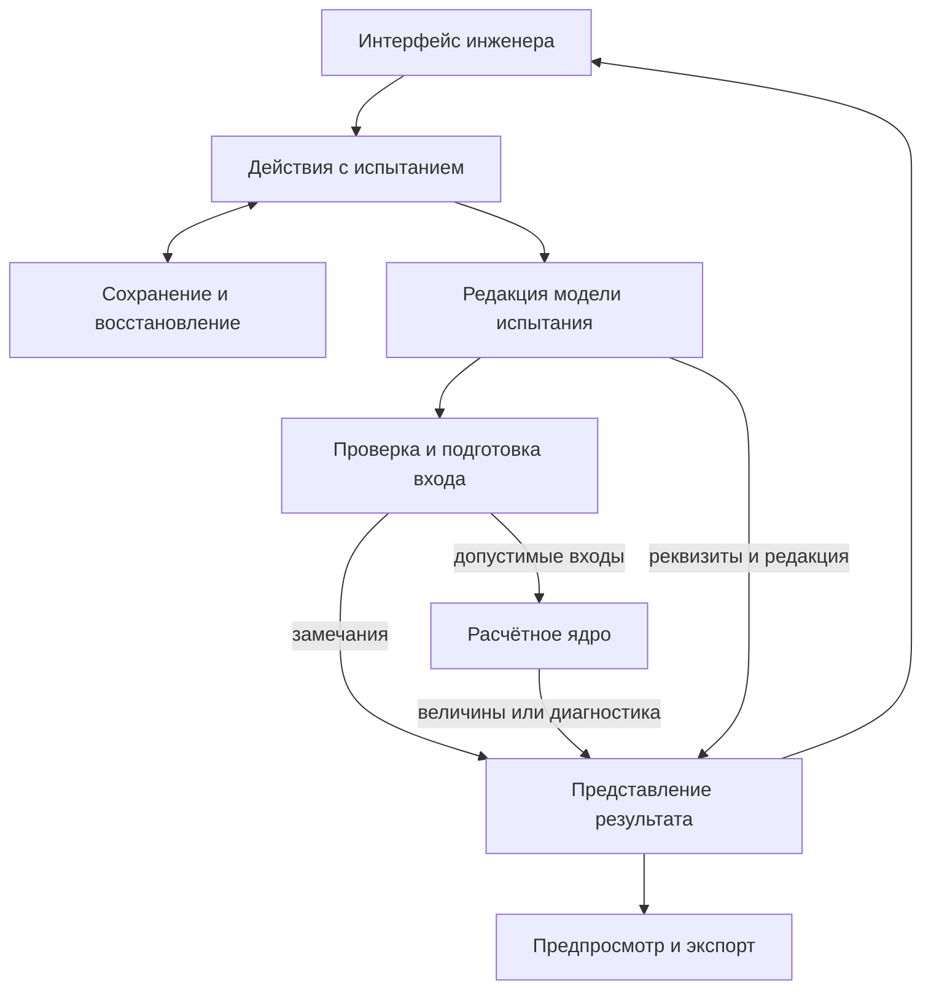

# Архитектура веб-калькулятора ВСЗ

**Проект 05-1.** Для MVP предлагается статическое приложение с интерфейсом на React и независимым вычислительным ядром на TypeScript. Инженер работает с измерениями на своём устройстве. Для переноса между рабочими местами он сохраняет файл испытания. Решение ожидает согласования в [ADR-0001](../decisions/ADR-0001-application-architecture.md).

## 1. Назначение и границы

Одна запись соответствует испытанию одной линейной оси с полным ходом до 2000 мм включительно. Инженер указывает ось и условия, задаёт переменное число позиций, вводит для каждой позиции пять измеренных отклонений в направлении ↑ и пять в направлении ↓. После проверки он может рассчитать характеристики, проследить их до позиции, сохранить испытание, открыть его повторно и подготовить отчёт. Источник отклонения — фактическое измерение со знаком. Одна команда ЧПУ недостаточна. [Нормативная область v0.1](../methodology/scope.md) и [требования MVP](../product/requirements.md).

Архитектура обслуживает четыре спроектированных экрана и одинаковый адрес наблюдения на ПК и телефоне. Пределы применимости подтверждает специалист. Решение о годности станка относится к процедуре приёмки. Расчётный отчёт и проект протокола сохраняют свой фактический статус. [Сценарии](../product/user-flows.md), [схемы экранов](../product/ui-wireframes.md) и [матрица требований MVP](../iterations/04-product-ux.md#матрица-соответствия-mvp).

## 2. Рассмотренные технологии

| Критерий для ВСЗ | А · TypeScript, HTML/CSS, Vite | Б · React, TypeScript, HTML/CSS, Vite | В · клиент TypeScript, сервер PHP или Python, API |
| --- | --- | --- | --- |
| Сложность реализации | Мало зависимостей. Синхронизацию полей, замечаний и редакций нужно организовать вручную. | Добавляются компоненты React и управление их состоянием. Одна модель питает четыре экрана. | Нужно спроектировать два приложения, передачу данных, обработку отказов и совместимый выпуск версий. |
| Соответствие UX | Весь MVP выполним. Больше ручной работы для фокуса и перехода между представлениями. | Удобно связать ячейку, мобильную карточку и список ошибок по одному ID. Семантику таблиц и клавиатуру всё равно проверяют отдельно. | Те же экраны возможны. Для каждого запроса расчёта нужны состояние ожидания и защита от запоздавшего ответа. |
| Надёжность | После загрузки вычисление локально. Рассинхронизация DOM и модели — риск реализации. | Расчёт также локален. Ошибки сохранения, устаревшая редакция и состояние черновика общие для экранов. | Доступность расчёта зависит также от сети, API и совместимости версий. Возможны централизованные резервные копии. |
| Точность | Ядро TS допускает независимую проверку, включая потерю точности в binary64. | То же ядро и те же эталоны. React влияет на показ и ввод, арифметика от него изолирована. | На сервере можно выбрать повышенную точность. Порядок операций, передачу десятичных строк и допуски всё равно нужно подтвердить. |
| Зависимость от сторонних сервисов | Ресурсы и примеры можно включить в сборку. | React также поставляется в сборке. Внешний сервис для расчёта не требуется. | ВСЗ может владеть сервером. Работоспособность клиента зависит от доступности этого сервиса. |
| GitHub Pages | Достаточно статической сборки. | Достаточно статической сборки. | На Pages размещается клиент. Для рабочего расчёта нужен отдельный адрес API. |
| Beget | Достаточно раздачи статических файлов по HTTPS. | Аналогичное размещение на поддомене. | Требуются подходящая среда для PHP или Python и доступ к API. Поддержку процесса, версии и лимитов проверяют по тарифу. |
| Требования к серверу | Веб-сервер для статики. Сборка вне хостинга. | Те же требования. Node.js нужен на рабочем месте сборки или в CI. | Среда исполнения, журналирование, мониторинг и обновления. Для серверного хранения также БД и восстановление. |
| Конфиденциальность измерений | Значения остаются на устройстве. Важны доступ к рабочему месту и обращение с файлами. | То же. График, отчёт и восстановление можно выполнить без сетевого запроса с измерениями. | Исходные измерения уходят на сервер. Требуются права доступа, сроки хранения и правила для журналов и копий. |
| Сопровождение | Меньше обновляемых пакетов. По мере роста экранов растут затраты на ручное обновление представлений. | Один статический выпуск и независимое ядро. Дополнительная работа — сопровождать React и проверять поведение формы после обновлений. | Нужно сопровождать клиент и сервер, восстанавливать сервис и согласовывать изменения API. |
| Тестирование | Ядро в Node.js, отдельно проверка событий DOM и браузера. | То же сравнение ядра в Node.js, затем проверки компонентов и нескольких сквозных сценариев в браузере. | Помимо ядра и UI нужны проверки сериализации, версий API, задержек, повторных запросов и сбоев сети. |
| Дальнейшее расширение | Новый отчёт или представление потребует явной привязки к общей модели. | Можно добавлять экраны и способы экспорта без второго вычислителя. При обоснованной потребности подключается новое хранилище. | Подходит для общего архива, нескольких пользователей, разграничения прав или обязательного централизованного расчёта. |

Сравнение предполагает одинаковый нормативный профиль и один набор эталонов у всех трёх вариантов. Статический хостинг Pages и настройка базового пути сборки описаны в [GitHub Docs](https://docs.github.com/en/pages/getting-started-with-github-pages/what-is-github-pages) и [руководстве Vite](https://vite.dev/guide/static-deploy.html).

## 3. Рекомендуемый стек и альтернативы

**Вариант Б.** На ПК инженер исправляет ячейку, на телефоне видит тот же повтор в карточке позиции. После правки список ошибок, сводка, график и отчёт должны одновременно учитывать новую редакцию. Для этих уже согласованных сценариев общий источник состояния и небольшие представления React оправдывают одну дополнительную зависимость по сравнению с А. Самостоятельная разработка возможна по частям — сначала модель и проверяемое ядро, затем их подключение к экранам. [Принцип общего состояния в React](https://react.dev/learn/sharing-state-between-components).

Предлагаются обычные HTML-элементы и CSS для таблицы, формы и адаптивности, TypeScript со строгой проверкой типов, Vite для разработки и статической сборки. Проверка типов компилятором TypeScript — отдельный шаг при подготовке выпуска. Vitest в среде Node.js предлагается для проверок без браузера. Отдельный менеджер глобального состояния, библиотеку графиков и генератор PDF выбирать при 05-1 не требуется. [Документация Vite](https://vite.dev/guide/features.html) и [среды Vitest](https://vitest.dev/guide/environment.html).

А остаётся практичной альтернативой при существенном упрощении ввода и числа представлений. В стоит пересмотреть, если появится обязательный общий архив или политика ВСЗ потребует серверного расчёта. Ни сложность интерфейса, ни переход на сервер сами по себе не решают вопрос точности.

## 4. Архитектурная схема

Стрелки показывают движение данных при работе с испытанием. Прикладной слой выполняет действия пользователя и связывает компоненты. Обратная передача результата в интерфейс не создаёт программной зависимости ядра от экрана.

## 5. Компоненты и ответственность

| Компонент | Чем владеет | Что передаёт дальше |
| --- | --- | --- |
| Пользовательский интерфейс | Ввод, навигация, фокус, таблица или карточка позиции, переход из ошибки к полю. Вставка диапазона требует предпросмотра. | Намерение пользователя и исходный текст с адресом. Показывает полученные состояния, таблицу, график и отчёт. |
| Модель испытания | Ось и ход, участок, позиции, наблюдения, условия, источник, единицы, метод и редакция. Адрес наблюдения состоит из ID позиции, направления и номера повтора. | Снимок входов конкретной редакции. Незавершённый ввод, пустота и измеренный ноль различимы. |
| Проверка данных | Разбор текста, проверка единиц, размера и идентичности серий. Отдельно оценивает комплектность чисел, основания применимости и реквизиты отчёта. | Подготовленный числовой вход или адресные замечания. При полных числах и методической оговорке сохраняет статус предварительного анализа. |
| Математическое ядро | Детерминированное преобразование подготовленных наблюдений по указанным профилю, методу и версии алгоритма. | Неокруглённые позиционные и осевые характеристики, источники экстремумов либо диагностику вычисления. |
| Представление результатов | Подписи, локаль, единицы показа, шаг отображения, точки графика, текстовая таблица тех же рядов. | Сводку и детализацию одной редакции. Направления различимы по тексту и виду линий. |
| Хранение и восстановление | Сохранение и чтение черновика или расчёта, переносимая копия, обнаружение конфликтов и ошибок записи. | Подтверждение сохранённой редакции либо причину отказа. При открытии возвращает материал для проверки и восстановления. |
| Экспорт | Состав расчётного отчёта, предупреждения, предварительный просмотр, явная выдача пользователю. Позже — PDF по согласованной форме. | Отчёт с исходными наблюдениями, величинами, методом, версией и статусами этой редакции. |

## 6. Зависимости и движение данных

1. Прикладной слой принимает действие, вносит правку в модель и увеличивает редакцию изменённых входов. Общий адрес наблюдения сохраняется при сортировке и смене ширины. Исходная десятичная строка и единица остаются в записи.
2. По команде «Рассчитать» проверка готовит вход. Пропуск значения или неоднозначное направление блокируют поддерживаемый расчёт. При нуле позиций нет осевых итогов. Четыре полные позиции допускают предварительную арифметику с замечанием о плане. Отсутствующая дата относится к оформлению. Ни один из этих случаев не подменяется нулём.
3. Прикладной слой вызывает ядро с неизменяемым снимком. Он принимает ответ только для активного runId при совпадении [полного ключа расчёта](data-model.md#4-контракт-расчётного-результата), включая trialId, хеш входов и версию численной политики. При изменении расчётных входов прежний результат остаётся привязанным к старой редакции. Его выдача как текущего блокируется.
4. Таблица, график и отчёт используют один расчётный результат. Для графика сортируется копия точек по координате в мм, при этом сохраняются ID. Смена шага отображения не запускает арифметику и не изменяет исходники. Реквизиты и предупреждения берутся из проверенной записи для выдачи.
5. Хранение и экспорт вызываются через отдельные границы. Ядро получает только данные и параметры. Оно не импортирует React, DOM, средства построения графиков, файловый ввод-вывод, часы, сеть или серверные модули. Node.js нужен испытательному стенду, в производственном расчёте используются те же функции TypeScript в браузере.

## 7. Границы вычислительного ядра

| На границе ядра | Обязательство |
| --- | --- |
| Вход | Проверенные структурированные серии фактических знаковых отклонений. Координаты и ход выражены в мм, отклонения подготовлены в мкм без промежуточного округления для показа. Например, исходная строка «−0,0010» мм остаётся в модели, а проверенный вход содержит эквивалент −1 мкм даже для направления ↓. Обе серии именованы, у каждой пять повторов. Граница преобразования ядра получает точные нормализованные десятичные строки и адреса из исходного снимка для проверки d→b и влияния на характеристики. |
| Параметры | Явные идентификаторы метода s, профиля и его версии, версии алгоритма и численной политики. Для сопоставления с эталонами используется `sample-n-minus-1`, ожидающий согласования ВСЗ. Неизвестный метод даёт диагностируемый отказ. Молчаливая подмена метода исключена. |
| Позиционные данные | По каждому ID выдаются средние, дисперсии в мкм², s, границы, двустороннее среднее, Bᵢ, кандидаты повторяемости и Rᵢ, включая все определяющие ветви при равенстве. Позиционный расчёт можно независимо вызвать и проверить до агрегации по оси. |
| Итоги оси | A, A↑, A↓, E, E↑, E↓, M, R, R↑, R↓, B, B̄ в мкм. Идентичность позиции и направления экстремумов сохраняется. Значения таблицы, графика и отчёта происходят из одного результата. |
| Отказ | При потере различимости значимых входов, исчезновении малого сигнала или неконечном результате возвращаются стадия и доступный адрес поля или серии. Диагностика относится к вычислению текущей редакции. Она не устанавливает пригодность прибора или соответствие процедуры. |

**Численный блокер остаётся открытым.** В PRE-06 подготовлен [проект исправленных §9.2 и §9.4](../methodology/math-spec.md) и [воспроизведены контрпримеры](../validation/pre06-numerical-policy-verification.md). Агрегатор получает защищённые рабочие величины. Публичные поля получают собственный RN64 после установления истинных ветвей и экстремумов. Для начала разработки нужны согласования и независимая проверка этапа 06.

## 8. Подход к тестированию

Будущий тестовый стенд на TypeScript загружает записи по путям из манифеста, проверяет идентификаторы и контрольные суммы. Адаптер подаёт на вход ядра только входные измерения и параметры. Стенд независимо читает сохранённые ожидания над d. Для вычислительного слоя новой политики нужны отдельные удостоверенные ожидания над b и проверка точных источников экстремумов. При проверке малых разностей он сохраняет точность эталонных десятичных строк до сравнения. При расхождении указывает ID набора и позиции, направление, имя поля, ожидаемую и полученную величины с единицей и применённый критерий. Формат эталона служит испытательному стенду. Производственный формат испытания определяется отдельно. [Манифест](../../tests/fixtures/v1/manifest.json), [описание полей](../../tests/fixtures/v1/README.md) и [план проверок](../validation/reference-test-plan.md).

| Проверка | Свидетель и ожидаемое поведение |
| --- | --- |
| Полнота каталога | 53 осевых случая — 14 исходных положительных, 18 преобразованных и 21 отрицательный. Пропущенный файл, неизвестная версия и дубликат ID завершают прогон ошибкой. Отдельные примеры округления и стресс-опыты не прибавляются к 53. |
| Числа и направления | Для 32 положительных файлов сопоставить все 12 итогов и 16 числовых полей каждой позиции, затем источники экстремумов и равные ветви. Адреса и направления сравнивать точно. T04 выявляет потерю знака B̄, T07 — потерю равной ветви. Преобразованные пары проверяют смену направления, знака, порядка и единиц по описанию своего набора. |
| Некорректные и неполные испытания | Для N01–N10 получить фактическое решение из входа. Сопоставить его с `expected_validation`, включая возможность арифметики, применимость и оформление. Отличать отсутствие позиции, пустоту, ноль, неполную серию и отсутствие реквизитов. |
| Численная точность | Разделить ошибку перевода исходной десятичной записи в машинное число и ошибку алгоритма на уже представимых входах. Сопоставлять результаты до форматирования. P02-mixed-scale обязан обнаруживать ложный ноль локально. Проверять константные серии, коллизии входов и дисперсии с отдельной размерностью. В проекте §9.4 согласованию подлежат бюджеты преобразования входов и побитовая сверка с удостоверенным RN64 каждого поля над теми же b. |
| Представление и хранение | Отдельные проверки форматирования, сохранения и восстановления с пропусками, ошибкой записи и старой редакцией. Дополнительно — примеры P04 для десятичного исходника и вычисленного binary64. Шаг показа не влияет на числовой результат. |
| Браузерная интеграция | Позже подключить проверки полного пути T06, смены представления на 320 CSS px, клавиатуры, вставки, возврата фокуса и отказа сохранения. Сопоставлять показ и выгрузку с результатом той же редакции. |

Основной прогон ядра и правил данных выполняется в Node.js без DOM, Excel и сетевых сервисов. Прогон того же ядра в целевых браузерах дополнит проверку среды исполнения. Существующие независимые материалы Python сохраняют роль эталона. Разработка тестов и повторное вычисление эталонов выходят за объём 05-1.

## 9. Предварительное хранение и восстановление

| Вариант | Надёжность и сложность | Конфиденциальность | UX-015 · восстановление | UX-016 · отказ записи | UX-023 · контроль передачи |
| --- | --- | --- | --- | --- | --- |
| Локальный файл испытания | Переносим между устройствами и адресами сайта. Инженер отвечает за место хранения и копии. Умеренная сложность чтения и проверки. | Доступ получает владелец файла и те, кому он его передал. | В том числе черновик с пропусками. При открытии проверяются совместимость и полнота. | При отмене или отказе черновик остаётся в памяти. Новая копия позволяет сохранить предыдущую. | Открытие обрабатывается на устройстве. Файл передаётся по инициативе инженера. |
| IndexedDB | Транзакционная запись в браузере. Данные зависят от адреса сайта, браузерного профиля и доступного места. Очистка может удалить черновики. | Записи локальны для источника сайта. Общий профиль рабочего места требует учёта доступа. | Быстро продолжить испытание в том же профиле. | Подтверждать запись после завершения транзакции. При конфликте редакций предложить сохранить отдельную копию. | Сетевой передачи для сохранения не требуется. |
| localStorage | Простое синхронное хранилище строк с ограниченной квотой. Большой черновик требует сериализации. | Те же ограничения общего профиля и очистки данных сайта. | Пригодно для небольших настроек показа. Восстановление испытания на нём не основывается. | Сбой записи нужно обработать. Атомарное обновление нескольких зависимых записей потребует дополнительной логики. | Сетевой передачи не требует. Измерения в этом варианте для MVP не сохраняются. |
| Серверная база | Общий архив и управляемые копии возможны при наличии администратора. Требует API, прав, мониторинга и проверки восстановления. | Граница доверия включает сервер, его журналы и резервные копии. | Возможен доступ с другого устройства при доступном сервисе. | Требуются подтверждение записи сервером, обработка конфликтов и сбоя связи. | Для отправки нужна самостоятельная операция с понятными правами и составом данных. За пределами MVP. |

**Предложение для MVP — файл как переносимая копия и IndexedDB для продолжения локальной работы.** Автосохранение черновика допустимо только с видимым состоянием записи. Лишь успешно завершённая транзакция подтверждает локальную редакцию. Запуск скачивания обозначается как выдача файла браузеру. При отсутствии подтверждения записи на диск интерфейс не гарантирует наличие файла. При недоступности IndexedDB остаются редактирование и выдача файла. При открытии повреждённой или неподдерживаемой копии объясняется причина, открытое испытание сохраняется. После восстановления старого расчёта видны его метод и версия. Сохранённые итоги можно просмотреть как исторические. Новый расчёт начинается с исходных наблюдений. Уход из изменённой записи внутри приложения предлагает сохранить, остаться или явно отказаться от правок. Поля, версия и правила совместимости файла — задача 05-2. [IndexedDB](https://developer.mozilla.org/en-US/docs/Web/API/IndexedDB_API), [квоты и очистка](https://developer.mozilla.org/en-US/docs/Web/API/Storage_API/Storage_quotas_and_eviction_criteria) и [Web Storage](https://developer.mozilla.org/en-US/docs/Web/API/Web_Storage_API).

## 10. Демонстрационный режим

Обязательная функция демонстрационной сборки — открыть T06 из встроенного каталога публичных синтетических примеров. За загрузку отвечает **прикладной слой**. Он получает из каталога исходные измерения и создаёт отдельную редактируемую запись в модели. У записи, результата и отчёта сохраняется пометка **«Синтетические данные»**. Эталон и его ожидаемые числа доступны для проверки, расчёт вызывается обычным путём. Демонстрационная копия не характеризует реальный станок.

Проверяемый маршрут — открыть T06, рассчитать, увидеть B = 4 мкм и B̄ = 0,8 мкм. В рабочей копии изменить p03, 500 мм, ↑ № 5 с 20 на 0 мкм. Старый результат помечается устаревшим. После пересчёта все 12 итогов равны нулю. Повторное открытие исходного T06 восстанавливает 20 мкм. Если поле очистить, получается пропуск, блокирующий полный расчёт. Каталог допускает выбор остальных примеров T03–T07 через ту же операцию. [Исходный T06](../../tests/fixtures/v1/cases/valid/T06-single-outlier.json) и [эталон для сверки правки](../../tests/fixtures/v1/cases/valid/T01-zero.json).

## 11. Размещение на хостинге

| Режим | Что размещается | Особенности эксплуатации |
| --- | --- | --- |
| Предварительная демонстрация | Статическая сборка с публичными примерами на GitHub Pages либо отдельном статическом хостинге. | Для Pages проекта учитывается базовый путь репозитория. Переходы между экранами в рамках одной точки входа не требуют серверной обработки маршрутов. |
| Версия ВСЗ | Сборка из той же ревизии на отдельном поддомене предприятия с HTTPS, например на статическом сайте виртуального хостинга Beget. | Для корня поддомена используется соответствующий базовый путь. На хостинг передаются собранные файлы. Node.js, API и БД при эксплуатации не требуются. |

При сбое основной площадки демонстрационная копия на независимом адресе остаётся доступной при работе этой площадки. Разные адреса имеют разные браузерные хранилища. Для переноса работы между ними нужен заранее сохранённый файл, совместимая версия и разрешённое для этих данных место работы. Публичную демонстрацию можно продолжить на встроенном T06. Уже открытая вкладка с загруженными ресурсами может продолжать локальный расчёт. Холодный запуск без сети потребовал бы отдельного решения об автономной поставке. Адрес поддомена, DNS, сертификат и публикация относятся к этапу размещения. [Статическая сборка Vite](https://vite.dev/guide/static-deploy.html) и [поддомены и HTTPS у Beget](https://beget.com/ru/kb/manual/domeny-i-poddomeny).

## 12. Безопасность и конфиденциальность

Сборка содержит приложение и публичные синтетические примеры. Измерения реального испытания, комментарии и реквизиты обрабатываются на устройстве. Они не включаются в URL, сетевые журналы приложения, аналитику, внешние графики или публичный репозиторий. Шрифты, библиотеки и примеры поставляются со статикой. Вход, подписка и API ChatGPT для инженера не нужны.

Файл и вставленный диапазон считаются данными. Открытие проверяет структуру, версию, единицы и адреса, текст отображается безопасно, формулы из буфера не исполняются. Перед явным экспортом пользователь видит редакцию, состав измерений, реквизиты и предупреждения. На общем компьютере локальная запись доступна в соответствующем браузерном профиле. Ответственный инженер выбирает допустимое рабочее место и место для копии файла. Порядок очистки, ограничения импорта и проверки отсутствия сетевой передачи приведены в [плане реализации](implementation-plan.md#безопасность-и-хранение).

## 13. Открытые решения

- **Метролог и ответственные специалисты ВСЗ.** Открыты метод s (Q9/D13), размещение позиций и запас реверса, физический знак прибора и происхождение наблюдений (Q5/Q11), форма протокола и приёмочные допуски (Q10/Q12). Ядро не подменяет эти решения статусом расчёта.
- **Численная политика.** До программирования ядра требуется согласованное исправление §9.2 и §9.4. Открыты локальный порядок вычислений, критерии сравнения, проверенный диапазон, шаг и правило округления. Допуск численной сверки не служит допуском на станок.
- **Владелец продукта.** Подлежат согласованию стек и способы локального хранения из ADR-0001. Позднее потребуются целевые браузеры и правила работы с производственными файлами на общих ПК. Статус выбора лицензии указан в [состоянии проекта](../STATUS.md).

## 14. Передача в 05-2

Для проектирования формата даны границы данных — исходная десятичная запись и единица, устойчивая связь позиции, направления и повтора, редакция входов, профиль, метод и версия алгоритма, раздельные статусы, происхождение примера и связь результата с исходниками. В 05-2 правила сохранения и открытия расчёта и неполного черновика, проверки версии и различения исторического и текущего результата зафиксированы в [модели](data-model.md) и [контрактах](contracts.md). Схема тестовых фикстур остаётся независимым входом для адаптера. Итоги сквозной проверки и условия перехода к реализации приведены в [заключении 05-3](architecture-review.md) и [плане реализации](implementation-plan.md).
